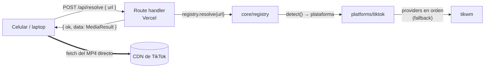

# GigaDown

Descargador personal de videos sin marca de agua. Pegás (o compartís) el link de un video de
TikTok y la app te devuelve el video listo para guardar en el celular o la compu.

> **Uso personal.** No se publica ni se promociona. Respetá los derechos de autor de lo que
> descargás y los términos de cada plataforma.

- **Producción:** https://giga-down.vercel.app
- **Stack:** Next.js 16 (App Router) · TypeScript estricto · Tailwind CSS 4 · Zod 4 · Vitest ·
  ESLint + Prettier · Vercel (Hobby)

## Cómo funciona

1. La app manda el link a `POST /api/resolve` (una función de Vercel).
2. La función le pregunta a un **proveedor** (hoy, la API pública de [tikwm](https://www.tikwm.com))
   y normaliza la respuesta a un `MediaResult`: autor, título, portada, duración y una lista de
   **variantes** (calidad, con o sin marca, URL, tamaño).
3. El navegador baja el archivo **directo del CDN** de la plataforma. El video nunca pasa por
   Vercel (las funciones tienen un límite de 4,5 MB por respuesta y un video de 20 s ya pesa
   ~5 MB): la API solo devuelve un JSON chico.



### Capas

```
src/
  app/                       Next.js: páginas, manifest y route handlers (finos)
    api/resolve/route.ts     POST { url } → { ok: true, data: MediaResult } | { ok: false, error }
    api/auth/route.ts        GET → valida la clave de acceso del header
  core/                      Dominio puro, sin dependencias de Next
    types.ts                 MediaResult, MediaVariant, Platform, Provider (esquemas Zod)
    errors.ts                AppError y códigos de error → status HTTP
    registry.ts              Detección por URL, timeout por proveedor y fallback
    url.ts                   Extrae el link de un texto compartido
  platforms/
    index.ts                 Lista de plataformas habilitadas + registry de la app
    tiktok/
      detect.ts              ¿Es un link de video de TikTok? (incluye vm./vt.tiktok.com)
      providers/tikwm.ts     Adaptador: llama a tikwm y normaliza a MediaResult
      index.ts               Define la plataforma y su lista ordenada de proveedores
  lib/                       Utilidades: auth, env, respuestas de la API, throttle, formato
    client/                  Solo navegador: llamada a la API, descarga, historial, preferencias
  components/                UI (cliente)
  hooks/                     Hooks de estado del cliente (localStorage vía useSyncExternalStore)
```

Reglas: los componentes y los route handlers no tienen lógica de negocio; `core/` no conoce a
Next ni a ningún proveedor; cada proveedor traduce su respuesta al modelo de `core/`.

### Contratos

```ts
interface Platform {
  id: string; // "tiktok"
  name: string; // "TikTok"
  detect(url: URL): boolean; // pura, sin red (también corre en el navegador)
  providers: readonly Provider[]; // en orden de preferencia
}

interface Provider {
  id: string; // "tikwm"
  resolve(url: string, context: { signal: AbortSignal }): Promise<MediaResult>;
}
```

- El registry prueba los proveedores en orden. Si uno falla (error, respuesta inválida o
  timeout), pasa al siguiente. Si fallan todos, informa el error más útil (`NOT_FOUND` le gana a
  `RATE_LIMITED`, que le gana a `TIMEOUT`, etc.).
- Las respuestas de la API tienen siempre la misma forma: `{ ok: true, data }` o
  `{ ok: false, error: { code, message } }`.

| Código            | HTTP | Cuándo                                                   |
| ----------------- | ---- | -------------------------------------------------------- |
| `UNSUPPORTED_URL` | 422  | El link no es de ninguna plataforma soportada            |
| `NOT_FOUND`       | 404  | El video no existe, es privado o el link está incompleto |
| `PROVIDER_ERROR`  | 502  | El proveedor falló o respondió algo inesperado           |
| `RATE_LIMITED`    | 429  | El proveedor está limitando pedidos (`Retry-After: 2`)   |
| `UNAUTHORIZED`    | 401  | Falta la clave de acceso o es incorrecta                 |
| `TIMEOUT`         | 504  | El proveedor no respondió a tiempo                       |
| `INVALID_REQUEST` | 400  | El body no es `{ "url": string }`                        |
| `INTERNAL_ERROR`  | 500  | Error inesperado (se loguea; el detalle no se expone)    |

## Correrlo local

Requisitos: Node.js 24 y npm.

```bash
npm install
```

```bash
cp .env.example .env.local
```

```bash
npm run dev
```

Abrí http://localhost:3000. Sin `ACCESS_KEY` en `.env.local`, la app queda abierta.

| Script              | Qué hace                                        |
| ------------------- | ----------------------------------------------- |
| `npm run dev`       | Servidor de desarrollo                          |
| `npm run build`     | Build de producción                             |
| `npm run lint`      | ESLint                                          |
| `npm run typecheck` | Genera los tipos de rutas de Next y corre `tsc` |
| `npm run test`      | Tests con Vitest (sin red: `fetch` mockeado)    |
| `npm run format`    | Prettier                                        |
| `npm run check`     | lint + typecheck + test + build                 |

Los íconos de la PWA se generan con `node scripts/generate-icons.mjs` (solo hace falta si cambia
el logo; los PNG están versionados).

## Variables de entorno

| Variable              | Obligatoria | Default | Descripción                                                                                           |
| --------------------- | ----------- | ------- | ----------------------------------------------------------------------------------------------------- |
| `ACCESS_KEY`          | No          | —       | Clave de acceso. Si está, la app la pide una vez por dispositivo y la API la exige en `x-access-key`. |
| `PROVIDER_TIMEOUT_MS` | No          | `10000` | Timeout por proveedor (entre 1000 y 60000 ms).                                                        |

Generá una clave larga y aleatoria:

```bash
node -e "console.log(require('node:crypto').randomBytes(24).toString('base64url'))"
```

Nunca la pongas en el código ni en un commit: va en `.env.local` (ignorado por git) y en Vercel.

## Deploy

El proyecto de Vercel está conectado al repo de GitHub: **cada push a `main` despliega solo** a
producción, y cada PR genera un preview.

Para cargar o cambiar la clave de acceso:

1. Vercel → proyecto **giga-down** → **Settings → Environment Variables**.
2. Agregá `ACCESS_KEY` con tu clave, marcada para **Production** (y **Preview** si querés).
3. **Deployments** → último deploy → **⋯ → Redeploy**. La página lee la variable al construirse,
   así que sin redeploy no toma el cambio.

CI: GitHub Actions corre lint, formato, typecheck, tests y build en cada push y PR
(`.github/workflows/ci.yml`).

## Cómo agregar una red social nueva

Ejemplo: Instagram con un proveedor hipotético `ejemplo`. Solo se tocan archivos nuevos y una
línea del registro.

1. **Detección** — `src/platforms/instagram/detect.ts`:

   ```ts
   import { normalizedHost } from "@/core/url";

   export function isInstagramVideoUrl(url: URL): boolean {
     return normalizedHost(url) === "instagram.com" && /^\/(reel|p)\/[\w-]+\/?$/.test(url.pathname);
   }
   ```

2. **Proveedor** — `src/platforms/instagram/providers/ejemplo.ts`: llamá a la API con la señal
   del registry, validá la respuesta con Zod y devolvé un `MediaResult`. Lanzá `AppError` con el
   código que corresponda (`NOT_FOUND`, `RATE_LIMITED`, `PROVIDER_ERROR`…).

   ```ts
   import { z } from "zod";
   import { AppError } from "@/core/errors";
   import type { Provider } from "@/core/types";

   const responseSchema = z.object({
     id: z.string(),
     user: z.string(),
     caption: z.string(),
     video: z.url(),
   });

   export const ejemploProvider: Provider = {
     id: "ejemplo",
     async resolve(url, { signal }) {
       const response = await fetch(`https://api.ejemplo.com/?url=${encodeURIComponent(url)}`, {
         signal,
       });
       if (response.status === 404) throw new AppError("NOT_FOUND");
       if (!response.ok) throw new AppError("PROVIDER_ERROR", `ejemplo: HTTP ${response.status}`);
       const data = responseSchema.parse(await response.json());
       return {
         platform: "instagram",
         provider: "ejemplo",
         id: data.id,
         sourceUrl: url,
         author: { username: data.user },
         title: data.caption,
         variants: [
           { id: "sd", quality: "sd", watermark: false, url: data.video, mimeType: "video/mp4" },
         ],
       };
     },
   };
   ```

3. **Plataforma** — `src/platforms/instagram/index.ts`:

   ```ts
   import type { Platform } from "@/core/types";
   import { isInstagramVideoUrl } from "./detect";
   import { ejemploProvider } from "./providers/ejemplo";

   export const instagram: Platform = {
     id: "instagram",
     name: "Instagram",
     detect: isInstagramVideoUrl,
     providers: [ejemploProvider],
   };
   ```

4. **Registro** — `src/platforms/index.ts`:

   ```ts
   export const platforms: readonly Platform[] = [tiktok, instagram];
   ```

5. **Tests** — copiá el patrón de `src/platforms/tiktok/`: tests de `detect` y del adaptador con
   un fixture de una respuesta real y `fetch` mockeado.

La UI, la API, el historial y la descarga funcionan sin cambios: la validación del cliente y los
textos ("Funciona con TikTok, Instagram") salen del mismo registro.

Para sumar **otro proveedor de TikTok** (por ejemplo, un proxy propio como respaldo), creá
`src/platforms/tiktok/providers/<nombre>.ts` y agregalo a la lista `providers` de
`src/platforms/tiktok/index.ts` en el orden que quieras.

## Usarlo desde el celular

### Android: menú Compartir

1. Abrí la app en **Chrome** → menú **⋮** → **Instalar app** (o _Agregar a la pantalla
   principal_ → _Instalar_).
2. En TikTok, en el video: **Compartir → Más** (o _Otras apps_) → **GigaDown**.
3. GigaDown se abre con el link y lo resuelve solo. Tocá **Descargar sin marca de agua**: queda en
   Descargas y en la galería. Si en cambio se abre el reproductor, tocá **⋮ → Descargar**.

Si GigaDown no aparece en el menú, desinstalala y volvé a instalarla desde Chrome (el menú
Compartir solo lo ofrecen las apps instaladas como WebAPK).

### iPhone: Atajo

En iOS las apps web no reciben contenido compartido, así que se usa un Atajo que abre GigaDown
con `?url=<link>`:

1. Abrí **Atajos** → **+** (nuevo atajo). Tocá el nombre de arriba → **Renombrar** → `GigaDown`.
2. Tocá **ⓘ** (Detalles) → activá **Mostrar en la hoja para compartir** → Listo.
3. En el primer bloque (_Recibir … de Compartir_): tocá el tipo de entrada y dejá solo **URL** y
   **Texto**. En _Si no hay entrada_ elegí **Obtener portapapeles**.
4. Agregá la acción **Codificar URL** (de _Codificar/decodificar URL_) y dejá **Entrada del
   atajo** como valor a codificar.
5. Agregá la acción **Texto** y escribí `https://giga-down.vercel.app/?url=` seguido de la
   variable **Texto codificado URL** (tocá _Variables_ arriba del teclado).
6. Agregá la acción **Abrir URL** con la variable **Texto**.
7. Para usarlo: en TikTok, **Compartir → Más (···)** → **GigaDown**. También podés tocar
   **Copiar enlace** y ejecutar el atajo desde la pantalla de inicio (usa el portapapeles).

Se abre en Safari y resuelve el video solo. Tocá **Descargar sin marca de agua** y después
**Guardar en Fotos** → **Guardar video**.

## Decisiones

Lo que no estaba definido de entrada y decidí durante el desarrollo:

- **npm** como gestor (ya estaba instalado; Vercel lo detecta solo). Node 24 fijado en
  `engines` y `.nvmrc`.
- **Sin shadcn/Radix.** Son pocos controles (input, botones, un selector de calidad): con
  Tailwind y componentes propios alcanza y no sumamos dependencias. Los colores son tokens CSS
  (`src/app/globals.css`) con modo claro/oscuro según el sistema.
- **El registry recibe las plataformas por parámetro** (`createRegistry(platforms)`), así `core/`
  no depende de `platforms/`. El registro de la app vive en `src/platforms/index.ts`.
- **Códigos de error extra:** `INVALID_REQUEST` (body mal formado) e `INTERNAL_ERROR` (error
  inesperado), además de `NETWORK_ERROR` solo en el cliente (sin conexión).
- **tikwm siempre con `hd=1`**, para tener la versión estándar y la HD en una sola llamada. Si
  tikwm repite el link sin marca en `wmplay`, no se ofrece la variante "con marca".
- **Calidades:** se muestran todas las variantes sin marca, de menor a mayor. Por defecto se
  preselecciona **Estándar** (H.264: se reproduce en todos lados) y después se recuerda la última
  que elegiste. Si la descarga de la elegida falla, se prueba con las otras sin marca (de mayor a
  menor) y se avisa con un mensaje breve. En las pruebas, la HD de tikwm venía en H.265 (720p) y
  la estándar en H.264 (576p).
- **Límite de tikwm (~1 pedido/s):** se espacian las llamadas 1,1 s dentro de cada instancia y,
  si igual responde "Free Api Limit", se reintenta **una sola vez** a los 1,5 s. Nada de
  reintentos en el cliente: el botón **Reintentar** es manual.
- **Timeout por proveedor** de 10 s (configurable) con `AbortSignal`: si vence, el registry pasa
  al siguiente proveedor. Si el cliente corta la conexión, se cancela todo.
- **Clave de acceso:** viaja en el header `x-access-key`, se compara en tiempo constante
  (SHA-256 + `timingSafeEqual`) y nunca se loguea. `GET /api/auth` sirve para avisar en el
  momento si la clave es incorrecta. Se guarda en `localStorage` del dispositivo.
- **Historial:** guarda solo metadatos (los links del CDN vencen en horas); al tocar un elemento
  se vuelve a resolver el link original.
- **`localStorage` a prueba de fallos:** si el navegador lo bloquea, los datos quedan en memoria
  mientras dure la pestaña y la app sigue funcionando.
- **Descarga:** `fetch` a Blob con barra de progreso. En iPhone se usa la hoja de Compartir con el
  archivo (opción **Guardar video**, va directo a Fotos); en Android y escritorio, `<a download>`.
  Si el CDN bloqueara CORS, se abre el video en otra pestaña y se muestra un botón para hacerlo a
  mano.
- **Portadas con ``** y no `next/image`: son URLs firmadas que vencen y optimizarlas gastaría
  cuota de Vercel sin beneficio.
- **`Referrer-Policy: no-referrer`** en toda la app: los CDN no lo necesitan y no exponemos la URL.
- **Sin service worker:** la app necesita red para funcionar y Chrome ya no exige uno para
  instalar la PWA ni para el menú Compartir.
- **La validación del cliente reusa el registry.** Eso incluye el código de los adaptadores en el
  bundle del navegador (pocos KB). Por eso los proveedores no deben leer secretos al importarse:
  si alguno los necesita, que los lea dentro de `resolve`.
- **Tipografías:** Geist (texto), Geist Mono (datos: duración, tamaños) y Bricolage Grotesque
  (titulares y marca).
- **Tamaños en unidades decimales** (1 MB = 1.000.000 bytes), como los muestran iOS y Android.

## Limitaciones conocidas

- **Dependencia total de tikwm.** Es una API pública no oficial, gratuita y sin garantías: puede
  cambiar el formato, caerse o cerrar. La arquitectura permite sumar otro proveedor como respaldo
  sin tocar el resto.
- **Límite de pedidos de tikwm (~1/s por IP).** Las funciones de Vercel salen por IPs
  compartidas, así que el límite puede aparecer aunque vos hagas un solo pedido. La app lo muestra
  como "Fueron muchos pedidos seguidos" y se resuelve reintentando a los segundos. El espaciado de
  1,1 s es por instancia, no global.
- **Los links de descarga vencen** (horas). Si un resultado quedó abierto mucho tiempo, la app
  avisa y ofrece buscarlo de nuevo.
- **Solo videos de TikTok.** Las publicaciones de fotos (carruseles) no están soportadas todavía.
- **HD en H.265:** puede no reproducirse en Windows sin la extensión HEVC, en Firefox o en
  Android viejos. Para esos casos está Estándar.
- **iOS no tiene share target** para apps web: se usa el Atajo, que abre Safari.
- **La clave de acceso no tiene límite de intentos.** Usá una clave larga y aleatoria.
